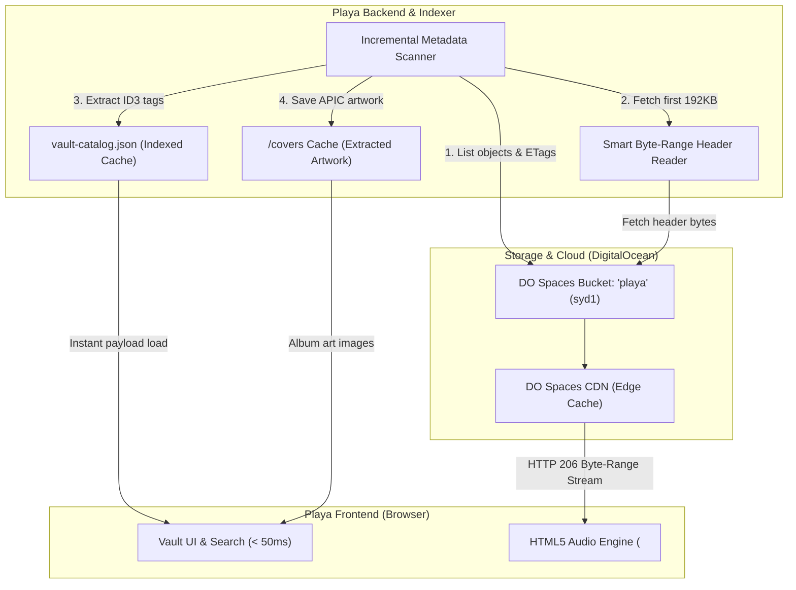
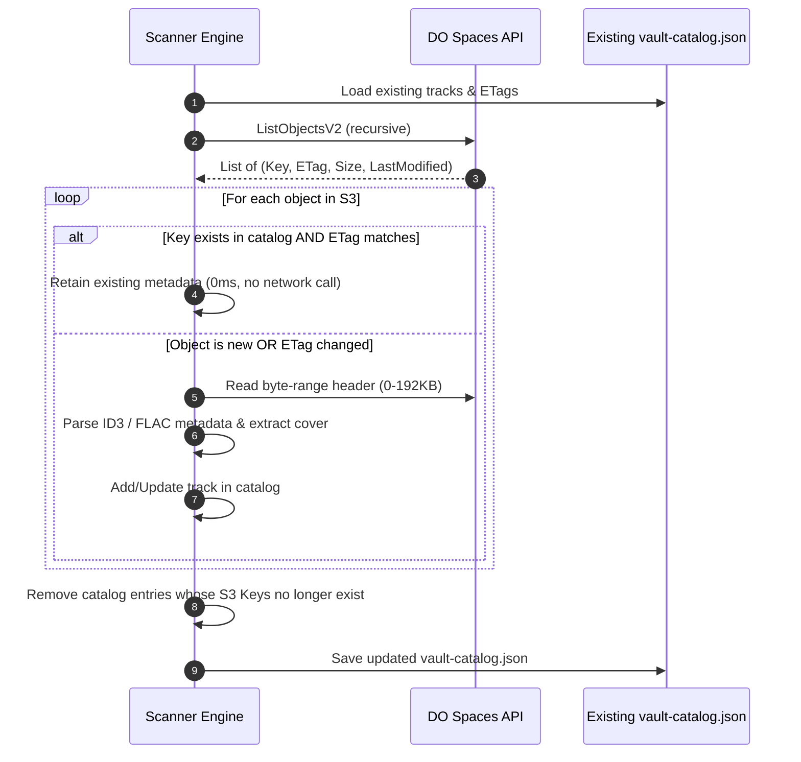

# Technical Architecture Plan: DigitalOcean Spaces Audio Vault & Catalog System

## 1. System Architecture Overview

The system decouples **metadata discovery** (fast, local JSON index) from **audio data delivery** (scalable, high-throughput cloud object storage with byte-range streaming).



---

## 2. Audio Streaming & Storage Layer

### DigitalOcean Spaces Configuration
* **Bucket**: `playa`
* **Region**: `syd1` (`https://syd1.digitaloceanspaces.com`)
* **CDN Endpoint**: `https://playa.syd1.cdn.digitaloceanspaces.com` (Spaces CDN provides free TLS, edge caching, and lower latency).

### Why HTTP 206 Byte-Range Streaming Matters
DigitalOcean Spaces natively implements the HTTP `Range` specification (`Accept-Ranges: bytes`). 
* When the user clicks play, the browser sends: `Range: bytes=0-` to fetch the audio container header and start playing within milliseconds.
* When the user scrubs to minute 45:20 of a 2-hour recording, the browser calculates the byte offset and sends: `Range: bytes=45239100-`.
* **Result**: Zero buffering wait time, and no need to download the full multi-megabyte audio file over FUSE.

---

## 3. Metadata Extraction: The Smart Range-Read Strategy

The biggest challenge with cloud storage is scanning speed. Downloading 50GB of audio to read ID3 tags is unfeasible. 

> [!TIP]
> **Performance Optimization: Chunked Metadata Reading**
> Audio metadata (ID3v2 tags, Vorbis comments, FLAC headers) lives at the **very beginning** of the file (first 64KB–192KB), while ID3v1 tags live in the **last 128 bytes**.
> Instead of downloading entire files, the scanner issues a single HTTP Range request for the first 192KB: `Range: bytes=0-196607`.

```typescript
// Conceptual range-fetch reader for metadata
async function fetchHeaderChunk(bucket: string, key: string): Promise<Buffer> {
  const command = new GetObjectCommand({
    Bucket: bucket,
    Key: key,
    Range: "bytes=0-196607", // Fetch only the first 192KB
  });
  const response = await s3Client.send(command);
  return streamToBuffer(response.Body);
}
```

This reduces scan bandwidth by **99.8%**, allowing an indexer to scan 1,000 tracks in under 15 seconds.

---

## 4. Catalog Data Schema (`vault-catalog.json`)

The scanner compiles all extracted metadata into a normalized, single-file database optimized for search, sorting, and instant UI rendering:

```json
{
  "version": "1.0.0",
  "vault": "playa",
  "region": "syd1",
  "cdnBaseUrl": "https://playa.syd1.cdn.digitaloceanspaces.com",
  "lastScannedAt": "2026-10-28T23:15:00.000Z",
  "stats": {
    "totalTracks": 384,
    "totalArtists": 42,
    "totalAlbums": 31,
    "totalDurationSeconds": 87420
  },
  "artists": [
    {
      "name": "Boards of Canada",
      "trackCount": 15,
      "albums": ["The Campfire Headphase", "Music Has the Right to Children"]
    }
  ],
  "tracks": [
    {
      "id": "trk_01h8x9p3...",
      "key": "Electronic/Boards of Canada/The Campfire Headphase/03 - Dayvan Cowboy.mp3",
      "streamUrl": "https://playa.syd1.cdn.digitaloceanspaces.com/Electronic/Boards%20of%20Canada/The%20Campfire%20Headphase/03%20-%20Dayvan%20Cowboy.mp3",
      "title": "Dayvan Cowboy",
      "artist": "Boards of Canada",
      "album": "The Campfire Headphase",
      "trackNumber": 3,
      "year": 2005,
      "genre": "IDM / Downtempo",
      "duration": 300.5,
      "bitrate": 320000,
      "codec": "MP3",
      "fileSize": 12040180,
      "etag": "\"4f5391d4e0e...\"",
      "lastModified": "2026-10-28T14:20:00Z",
      "coverArtPath": "/covers/trk_01h8x9p3.jpg"
    }
  ]
}
```

---

## 5. Incremental Synchronization Algorithm

To keep the catalog up-to-date without redundant processing, the scanner uses S3 `ListObjectsV2` diffing:



---

## 6. Security & Stream Access Strategies

Depending on whether your Space is public or private, we have two options for streaming audio to the browser:

| Option | Method | Latency | Pros | Cons |
| :--- | :--- | :--- | :--- | :--- |
| **A. Spaces CDN (Public-Read)** *(Recommended)* | Edge CDN URLs directly in `<audio src="...">` | ⚡ Lowest (< 30ms) | Zero server load, edge cached worldwide, instant scrubbing | Files are accessible to anyone with the exact URL hash |
| **B. Presigned S3 URLs** | Backend generates temporary 2-hour signed URLs | ⚡ Low (< 60ms) | Space remains 100% private | URLs expire, needing refresh if paused for hours |
| **C. Backend Streaming Proxy** | Express/Koa `res.status(206)` pipe | 🟡 Medium | 100% private, custom auth & access control | All audio traffic routes through your local server |

---

## 7. Implementation Plan & Milestones

### Phase 1: Core Scanner Module
* Implement `scanner.js` using `@aws-sdk/client-s3` and `music-metadata`.
* Support MP3, FLAC, WAV, AAC, M4A, OGG.
* Implement range-fetching for remote headers.
* Implement embedded cover art extractor (saves `.jpg` thumbnails to local static directory or Spaces `_covers/` folder).

### Phase 2: Synchronization & API Layer
* Add a `POST /api/vault/rescan` endpoint in Playa.
* Add an SSE (Server-Sent Events) progress stream so the UI shows: `Scanning 14/120: Boards of Canada - Dayvan Cowboy...`.
* Add `GET /api/vault/catalog` to serve the compressed JSON to the frontend.

### Phase 3: Player UI Integration
* Connect Playa’s store to the catalog payload.
* Bind the HTML5 `<audio>` player to the Spaces CDN stream URLs.
* Add a **"Sync Vault"** button in the header with a timestamp of the last scan.
